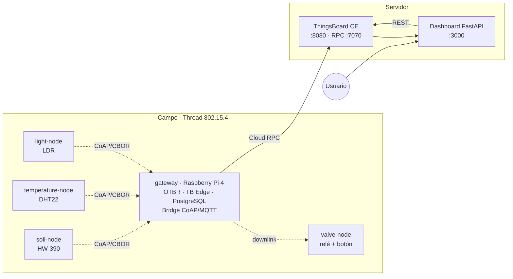
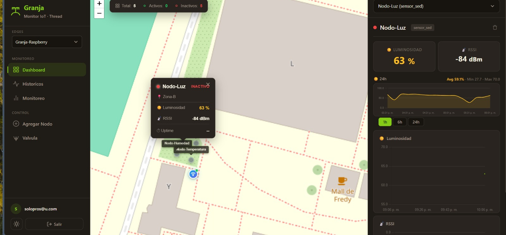

# Granja IoT

Sistema de agricultura de precisión sobre **Thread / IEEE 802.15.4**: cuatro nodos **ESP32-C6** de bajo consumo reportan telemetría a un **gateway de campo en Raspberry Pi 4**, que la publica en **ThingsBoard Edge** y la sincroniza con **ThingsBoard CE**. Un dashboard web **FastAPI + Leaflet + Chart.js** muestra el estado del cultivo y acciona el riego automáticamente.


---

## Índice

- [Arquitectura](#arquitectura)
- [Flujo de datos](#flujo-de-datos)
- [Dashboard](#dashboard)
- [Estructura del repositorio](#estructura-del-repositorio)
- [Nodos](#nodos)
- [Puesta en marcha](#puesta-en-marcha)
- [Servicios y puertos](#servicios-y-puertos)
- [Control automático de riego](#control-automático-de-riego)
- [Stack tecnológico](#stack-tecnológico)
- [Documentación](#documentación)
- [Acceso y credenciales de desarrollo](#acceso-y-credenciales-de-desarrollo)

---

## Arquitectura

El sistema se divide en dos planos: **campo** (red Thread y gateway local, funciona sin internet) y **servidor** (ThingsBoard central y dashboard público).



| Plano | Dónde corre | Responsabilidad |
|-------|-------------|-----------------|
| Nodos | ESP32-C6 | Muestreo del sensor, decisión de envío, modo SED |
| Gateway | Raspberry Pi 4 | Border Router Thread, ThingsBoard Edge, bridge CoAP↔MQTT, riego automático |
| Servidor | PC / host | ThingsBoard CE, dashboard web, acceso remoto |

---

## Flujo de datos

**Uplink (sensor → dashboard)**

```
ESP32-C6 ──POST CBOR──► Bridge :5685 ──MQTT──► TB Edge :1883
  {id, l, r, u}          decode + publish        telemetría
                                                     │ Cloud RPC
                                                     ▼
                                          TB CE :8080 ──REST──► Dashboard :3000
```

**Downlink (dashboard → actuador)**

```
Dashboard ──REST──► TB CE ──Cloud RPC──► TB Edge ──MQTT──► Bridge
                                                             │ piggyback en la
                                                             ▼ respuesta CoAP
                                                        valve-node
```

El bridge no inicia conexiones hacia los nodos: los comandos viajan **adjuntos a la respuesta** del siguiente POST del nodo (piggyback sobre CoAP). Es lo que permite que un nodo durmiente reciba órdenes sin mantener el radio encendido.

---

## Dashboard

Interfaz web de monitoreo y control (`dashboard/`, puerto `3000`) sobre el mapa de la finca. El panel izquierdo agrupa la navegación y las acciones, el mapa central ubica los nodos que reportan telemetría y el panel derecho muestra el detalle del nodo seleccionado con su histórico.



| Zona | Elementos |
|------|-----------|
| Encabezado | Selector de *edge* (`Granja-Raspberry`) y contador de nodos: **Total**, **Activos** e **Inactivos** |
| Menú **Monitoreo** | `Dashboard` (mapa en vivo), `Históricos` (consultas por rango) y `Monitoreo` (vista unificada de sensores) |
| Menú **Control** | `Agregar Nodo` (aprovisionamiento) y `Válvula` (apertura/cierre manual del riego) |
| Mapa | Marcadores de cada nodo (`Nodo-Luz`, `Nodo-Temperatura`, `Nodo-Humedad`, `BOMBA`) con estado activo/inactivo y tooltip de lecturas |
| Panel derecho | Selector de nodo, estado (`sensor_sed`), `Luminosidad`, `RSSI`, gráfica histórica y rangos de tiempo `1h` / `6h` / `24h` |

El nodo seleccionado muestra su última lectura, el promedio del periodo y los valores mínimo/máximo de la serie. Los nodos sin reportes recientes aparecen como **inactivos** en el contador y con el indicador rojo en el mapa.

---

## Estructura del repositorio

```
.
├── firmware/                  # Firmware ESP-IDF de los nodos ESP32-C6
│   ├── nodes/
│   │   ├── light-node/        # Nodo-Luz        · LDR       · light %
│   │   ├── temperature-node/  # Nodo-Temperatura · DHT22    · temperature °C
│   │   ├── soil-node/         # Nodo-Humedad    · HW-390    · humidity %
│   │   └── valve-node/        # BOMBA           · relé GPIO · valve 0/1
│   └── README.md
├── gateway/                   # Gateway de campo (Raspberry Pi 4)
│   ├── bridge/                # Servidor CoAP + publisher MQTT + control de riego
│   ├── scripts/               # Arranque del stack y servicio ip6tables
│   ├── docker-compose.yml     # OTBR · ThingsBoard Edge · PostgreSQL · Bridge
│   └── README.md
├── dashboard/                 # Dashboard de monitoreo (FastAPI + Leaflet + Chart.js)
│   ├── app/                   # Backend, templates y SPA en JS
│   ├── scripts/               # Ejecución local y docker compose
│   ├── tools/                 # Utilidades de aprovisionamiento
│   ├── docker-compose.yml
│   └── README.md
├── infra/
│   └── thingsboard-ce/        # ThingsBoard CE central (PostgreSQL)
├── docs/
│   ├── architecture.md        # Protocolos, payloads y decisiones de diseño
│   ├── deployment.md          # Despliegue paso a paso
│   └── img/dashboard.png      # Captura del dashboard en operación
└── README.md
```

---

## Nodos

| Nodo | Carpeta | Sensor / actuador | `NODE_ID` | Variable publicada | Zona |
|------|---------|-------------------|-----------|--------------------|------|
| Nodo-Luz | `light-node` | LDR (ADC) | `Nodo-Luz` | `light` (%) | A |
| Nodo-Temperatura | `temperature-node` | DHT22 | `Nodo-Temperatura` | `temperature` (°C) | B |
| Nodo-Humedad | `soil-node` | HW-390 (ADC) | `Nodo-Humedad` | `humidity` (%) | C |
| BOMBA | `valve-node` | Relé + pulsador | `BOMBA` | `valve` (0/1) | D |

Todos operan como **Sleepy End Device**: radio apagado entre sondeos, CPU en *tickless idle* y envío solo por cambio significativo o heartbeat.

---

## Puesta en marcha

### Requisitos

| Herramienta | Uso |
|-------------|-----|
| ESP-IDF ≥ 5.5 | Compilar y flashear el firmware |
| Docker + Docker Compose | Gateway y dashboard |
| Python 3.12 | Desarrollo del bridge y del dashboard |
| nRF52840 | RCP del Border Router Thread |

### 1. Servidor central

```bash
cd infra/thingsboard-ce
docker compose up -d          # consola en http://localhost:8080
```

### 2. Dashboard

```bash
cd dashboard
./scripts/compose-up.sh       # build + run en http://localhost:3000
```

### 3. Gateway de campo (Raspberry Pi)

```bash
ssh finca@<ip-raspberry>
cd ~/gateway
./scripts/up.sh               # OTBR + TB Edge + PostgreSQL + Bridge
```

### 4. Nodos

```bash
cd firmware/nodes/light-node
. $IDF_PATH/export.sh
idf.py set-target esp32c6
idf.py build
idf.py -p /dev/ttyACM0 flash monitor
```

Repetir en cada carpeta de nodo. El detalle de cada paso está en [`docs/deployment.md`](docs/deployment.md).

---

## Servicios y puertos

| Puerto | Servicio | Host |
|--------|----------|------|
| `3000` | Dashboard (FastAPI) | PC |
| `8080` | ThingsBoard CE (web + API) | PC |
| `7070` | ThingsBoard Cloud RPC | PC |
| `8081` | OTBR REST API | Raspberry Pi |
| `8082` | ThingsBoard Edge (web) | Raspberry Pi |
| `8083` | OTBR Web GUI | Raspberry Pi |
| `1883` | MQTT de ThingsBoard Edge | Raspberry Pi |
| `5685/udp` | Bridge CoAP (`POST /readings`) | Raspberry Pi |

---

## Control automático de riego

El `IrrigationController` del bridge evalúa la telemetría entrante y decide sobre la válvula:

| Condición | Acción |
|-----------|--------|
| Humedad de suelo < 30 % **y** luz ≥ 10 % **y** temp < 35 °C **y** hora entre 6 y 23 **y** cooldown ≥ 60 s | Abrir |
| Humedad de suelo ≥ 70 % | Cerrar de inmediato |

Los umbrales se  configuran en `gateway/bridge/config.yaml`. La lógica completa está en [`docs/architecture.md`](docs/architecture.md#control-automático-de-riego).

---

## Stack tecnológico

| Capa | Tecnología |
|------|-----------|
| Red IoT | Thread (IEEE 802.15.4) + 6LoWPAN + IPv6 |
| Aplicación IoT | CoAP + CBOR |
| Firmware | ESP-IDF · FreeRTOS · OpenThread · libcoap |
| Gateway | OpenThread Border Router (Docker) |
| Plataforma IoT | ThingsBoard Edge 4.2.0EDGE + ThingsBoard CE |
| Bridge | Python · aiocoap · paho-mqtt |
| Dashboard | FastAPI · Jinja2 · Leaflet · Chart.js (SPA vanilla) |
| Almacenamiento | PostgreSQL 16 |
| Contenedores | Docker Compose |
| Acceso remoto | Tailscale Funnel (HTTPS) |

---

## Documentación

| Documento | Contenido |
|-----------|-----------|
| [`docs/architecture.md`](docs/architecture.md) | Protocolos, formato CBOR, tópicos MQTT, estrategia de bajo consumo, lógica de riego |
| [`docs/deployment.md`](docs/deployment.md) | Despliegue de servidor, gateway y nodos; acceso remoto; diagnóstico |
| [`firmware/README.md`](firmware/README.md) | Estructura del firmware y guía de compilación |
| [`gateway/README.md`](gateway/README.md) | Servicios del gateway y operación en campo |
| [`dashboard/README.md`](dashboard/README.md) | API REST, páginas y diseño de la interfaz |
| [`infra/thingsboard-ce/README.md`](infra/thingsboard-ce/README.md) | Servidor ThingsBoard CE y sincronización con los Edge |

---

## Acceso y credenciales de desarrollo

Valores por defecto de un entorno de laboratorio. **Deben cambiarse antes de cualquier despliegue real.**

| Sistema | URL | Usuario | Contraseña |
|---------|-----|---------|------------|
| ThingsBoard CE | `http://localhost:8080` | `tenant@thingsboard.org` | `tenant` |
| ThingsBoard Edge | `http://<ip-raspberry>:8082` | `tenant@thingsboard.org` | `tenant` |
| Dashboard (tenant) | `http://localhost:3000` | `tenant@thingsboard.org` | `tenant` |
| Dashboard (customer) | `http://localhost:3000` | `juan@finca.com` | `juan123` |

El dashboard puede exponerse por HTTPS con **Tailscale Funnel**; el procedimiento está en [`docs/deployment.md`](docs/deployment.md#acceso-remoto).
